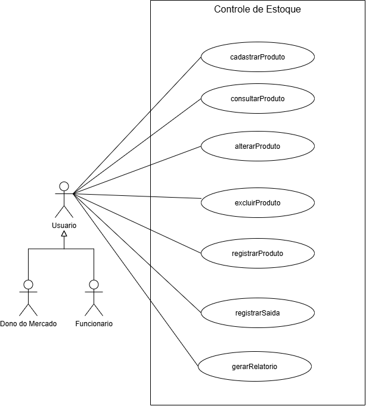

# 4.2.2 Modelagem de Casos de Uso

## Atores

Dois papéis utilizam o sistema de controle de estoque do mercado: o dono e os funcionários. Ambos utilizam o sistema para acompanhar os produtos e as movimentações do estoque, respeitando as permissões de acesso.

| Ator            | Quem é                                                                     | O que faz no sistema                                                                                              |
| --------------- | -------------------------------------------------------------------------- | ----------------------------------------------------------------------------------------------------------------- |
| Dono do mercado | Responsável pelo mercado e pelo acompanhamento do estoque.                 | Cadastra, consulta, altera e exclui produtos, registra entradas e saídas e gera relatórios.                       |
| Funcionário     | Pessoa que trabalha no mercado e utiliza o sistema nas atividades diárias. | Consulta produtos e quantidades em estoque e registra entradas e saídas de mercadorias, conforme sua autorização. |

## Casos de uso

Cada caso de uso representa uma funcionalidade que o usuário pode realizar no sistema. Os nomes foram mantidos conforme os requisitos funcionais da seção 4.2.1.

| Caso de uso       | Ator                                     | Atende      |
| ----------------- | ---------------------------------------- | ----------- |
| Cadastrar Produto | Dono do mercado e Funcionário autorizado | RF01        |
| Consultar Produto | Dono do mercado e Funcionário            | RF02 e RF07 |
| Alterar Produto   | Dono do mercado e Funcionário autorizado | RF03        |
| Excluir Produto   | Dono do mercado e Funcionário autorizado | RF04        |
| Registrar Entrada | Dono do mercado e Funcionário autorizado | RF05        |
| Registrar Saída   | Dono do mercado e Funcionário autorizado | RF06        |
| Gerar Relatório   | Dono do mercado e Funcionário autorizado | RF08        |

O requisito RF07 — Consultar Estoque — está associado ao caso de uso Consultar Produto, pois a consulta das quantidades disponíveis faz parte da verificação das informações dos produtos.

## Diagrama de casos de uso

Figura 1 – Diagrama de casos de uso do Sistema de Controle de Estoque

Fonte: Autoria própria (2026).

O diagrama de casos de uso representa os atores Dono do mercado e Funcionário fora da fronteira do sistema e as funcionalidades dentro dela. Os atores são conectados aos casos de uso que podem realizar, de acordo com suas permissões. Não foram utilizados relacionamentos `<<include>>` ou `<<extend>>`, pois, neste modelo inicial, não foi identificada uma etapa compartilhada obrigatória ou uma funcionalidade opcional que justificasse esses relacionamentos.

## Especificação do caso de uso principal

Registrar Entrada é o caso de uso principal porque permite registrar as mercadorias recebidas pelo mercado e atualizar as quantidades disponíveis no estoque, contribuindo para manter as informações organizadas.

| Campo        | Descrição                                                                                             |
| ------------ | ----------------------------------------------------------------------------------------------------- |
| Caso de uso  | Registrar Entrada                                                                                     |
| Ator         | Dono do mercado ou Funcionário autorizado                                                             |
| Pré-condição | O usuário deve ter autorização para registrar entradas, e o produto deve estar cadastrado no sistema. |
| Pós-condição | A entrada da mercadoria fica registrada e a quantidade disponível do produto é atualizada.            |

Fluxo principal

1. O usuário solicita o registro de entrada de uma mercadoria.
2. O sistema solicita a identificação do produto e a quantidade recebida.
3. O usuário informa os dados da mercadoria.
4. O sistema verifica se o produto está cadastrado e se a quantidade informada é válida.
5. O sistema apresenta os dados da entrada para conferência.
6. O usuário confirma o registro da entrada.
7. O sistema registra a movimentação e atualiza a quantidade disponível no estoque.
8. O sistema confirma que a entrada foi registrada com sucesso.

Fluxo alternativo

\- A1, no passo 4: a quantidade informada é inválida. O sistema informa que a quantidade precisa ser corrigida. O usuário informa uma quantidade válida, e o fluxo volta ao passo 3.

Fluxos de exceção

- E1, no passo 4: o produto não está cadastrado. O sistema informa que o produto não foi encontrado e não registra a entrada. O caso de uso termina sem a pós-condição.
- E2, no passo 7: ocorre uma falha no registro. O sistema informa que não foi possível concluir a operação e não confirma a atualização do estoque. O caso de uso termina sem a pós-condição.

A diferença entre o fluxo alternativo e o fluxo de exceção é que, no primeiro, a operação pode continuar após a correção dos dados. Na exceção, a operação termina sem concluir o registro da entrada.

## Rastreabilidade com a 4.2.1

| Requisito                | Caso de uso       | Onde aparece                                       |
| ------------------------ | ----------------- | -------------------------------------------------- |
| RF01 — Cadastrar Produto | Cadastrar Produto | Elipse do diagrama.                                |
| RF02 — Consultar Produto | Consultar Produto | Elipse do diagrama.                                |
| RF03 — Alterar Produto   | Alterar Produto   | Elipse do diagrama.                                |
| RF04 — Excluir Produto   | Excluir Produto   | Elipse do diagrama.                                |
| RF05 — Registrar Entrada | Registrar Entrada | Elipse e especificação do caso de uso principal.   |
| RF06 — Registrar Saída   | Registrar Saída   | Elipse do diagrama.                                |
| RF07 — Consultar Estoque | Consultar Produto | Consulta das quantidades disponíveis dos produtos. |
| RF08 — Gerar Relatório   | Gerar Relatório   | Elipse do diagrama.                                |

Todo requisito tem lugar. Os oito requisitos funcionais estão representados na modelagem. O RF07 não precisa de uma elipse própria, pois está relacionado à consulta dos produtos e de suas quantidades.

Toda elipse tem requisito. Todos os casos de uso apresentados correspondem a requisitos funcionais definidos na seção 4.2.1.

O que a especificação mudou. O detalhamento do registro de entrada mostrou a necessidade de prever situações como quantidade inválida, produto não cadastrado e falha no registro. Essas situações foram incluídas nos fluxos alternativo e de exceção para orientar o desenvolvimento do sistema.
