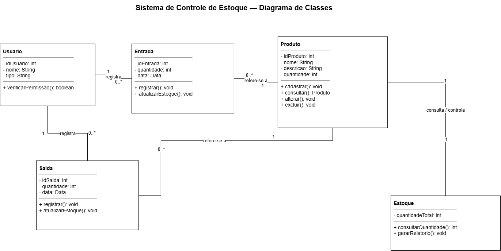

# 4.2.3 Modelagem de Classes

## Dos substantivos às classes

A partir do caso de uso **Registrar Entrada** e dos requisitos funcionais definidos na seção 4.2.1, foram identificados os substantivos relevantes para a modelagem das classes.

| Substantivo | Origem | Decisão |
| -- | -- | -- |
| Produto | RF01, RF02, RF03 e RF04 | Classe Produto |
| Nome | Dados do produto | Atributo da classe Produto |
| Descrição | Dados do produto | Atributo da classe Produto |
| Quantidade | RF05, RF06 e RF07 | Atributo da classe Produto |
| Entrada | RF05 | Classe Entrada |
| Saída | RF06 | Classe Saida |
| Estoque | RF07 | Atributo e operações relacionadas à quantidade dos produtos |
| Relatório | RF08 | Funcionalidade do sistema, sem necessidade de uma classe própria neste modelo |
| Usuário | Atores da seção 4.2.2 e RNF02 | Classe Usuario |

## Classes

As classes foram definidas considerando os dados que precisam ser armazenados e as operações necessárias para atender aos requisitos do sistema.

| Classe | Atributos | Operações | Origem |
| -- | -- | -- | -- |
| Produto | `idProduto: int` `nome: String` `descricao: String` `quantidade: int` | `cadastrar(): void` `consultar(): Produto` `alterar(): void` `excluir(): void` | RF01, RF02, RF03, RF04 e RF07 |
| Entrada | `idEntrada: int` `quantidade: int` `data: Data` | `registrar(): void` `atualizarEstoque(): void` | RF05 e fluxo principal de Registrar Entrada |
| Saida | `idSaida: int` `quantidade: int` `data: Data` | `registrar(): void` `atualizarEstoque(): void` | RF06 |
| Usuario | `idUsuario: int` `nome: String` `tipo: String` | `verificarPermissao(): boolean` | Atores da seção 4.2.2 e RNF02 |
| Estoque | `quantidadeTotal: int` | `consultarQuantidade(): int` `gerarRelatorio(): void` | RF07 e RF08 |

## Diagrama de Classes

**Figura 2 –** Diagrama de classes do Sistema de Controle de Estoque.

**Fonte:** Autoria própria (2026).

A classe Produto se relaciona com as classes Entrada e Saida, pois um produto pode possuir vários registros de movimentação. Cada entrada ou saída está associada a um produto. A classe Usuario pode registrar várias movimentações no sistema. A classe Estoque é responsável por consultar as quantidades disponíveis e gerar relatórios.

Não foi utilizada herança, pois as classes não apresentam uma relação clara de especialização. Também não foram utilizadas composição ou agregação, pois ainda não foi definido se a exclusão de um produto deve excluir ou preservar o histórico de suas movimentações.

## Teste com Objetos

Para testar a modelagem, foi considerado um cenário em que o funcionário cadastra um produto, registra uma entrada de 20 unidades e depois registra uma saída de 5 unidades.

| Objeto | Classe | Valores dos atributos |
| -- | -- | -- |
| `arroz` | Produto | `idProduto = 1`, `nome = "Arroz"`, `descricao = "Pacote de arroz"`, `quantidade = 15` |
| `entrada1` | Entrada | `idEntrada = 1`, `quantidade = 20`, `data = 26/10/2026` |
| `saida1` | Saida | `idSaida = 1`, `quantidade = 5`, `data = 26/10/2026` |
| `funcionario1` | Usuario | `idUsuario = 1`, `nome = "Funcionário"`, `tipo = "Funcionário"` |
| `estoque1` | Estoque | `quantidadeTotal = 15` |

Os objetos `entrada1` e `saida1` estão relacionados ao produto `arroz`. O objeto `funcionario1` está relacionado às duas movimentações, pois foi ele quem as registrou. O objeto `estoque1` representa a consulta da quantidade disponível após as movimentações.

O teste confirma que o sistema consegue representar um produto com várias movimentações e calcular a quantidade final em estoque: 20 unidades de entrada menos 5 unidades de saída resultam em 15 unidades disponíveis.

## Rastreabilidade com a seção 4.2.2

A tabela apresenta a relação entre as operações das classes e os requisitos funcionais definidos anteriormente.

| Operação ou atributo | Classe | Origem na seção 4.2.2 |
| -- | -- | -- |
| `cadastrar()` | Produto | RF01 – Cadastrar Produto |
| `consultar()` | Produto | RF02 – Consultar Produto |
| `alterar()` | Produto | RF03 – Alterar Produto |
| `excluir()` | Produto | RF04 – Excluir Produto |
| `registrar()` | Entrada | RF05 – Registrar Entrada |
| `atualizarEstoque()` | Entrada | RF05 e passo 7 do fluxo principal de Registrar Entrada |
| `registrar()` | Saida | RF06 – Registrar Saída |
| `atualizarEstoque()` | Saida | RF06 – Registrar Saída |
| `quantidade: int` | Produto | RF07 – Consultar Estoque |
| `consultarQuantidade()` | Estoque | RF07 – Consultar Estoque |
| `gerarRelatorio()` | Estoque | RF08 – Gerar Relatório |
| `verificarPermissao()` | Usuario | RNF02 – Segurança |

Todas as operações apresentadas possuem origem em um requisito funcional ou não funcional. Os passos do sistema relacionados ao cadastro, à consulta e às movimentações encontram correspondência nas classes e operações propostas.

A modelagem organizou as informações em classes específicas, separando os dados dos produtos, os registros de entrada e saída, os usuários e as funcionalidades de consulta do estoque e geração de relatórios. Alguns detalhes, como a preservação do histórico após a exclusão de produtos, ainda precisam ser confirmados com o dono do mercado.
