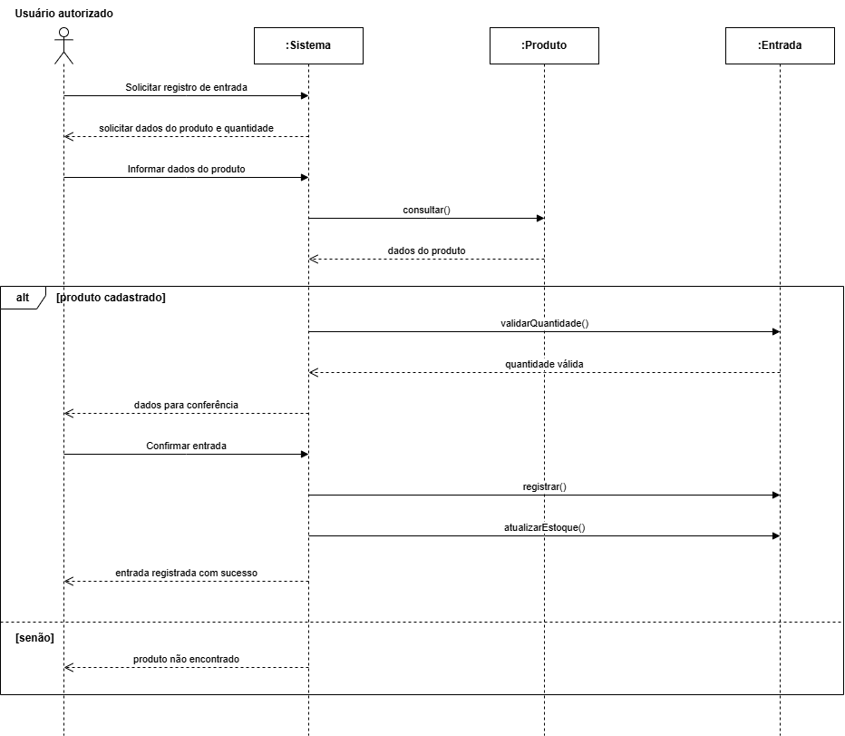

# 4.2.4 Modelagem de Sequência

## Do fluxo às mensagens

O diagrama de sequência conta um cenário do caso de uso como uma conversa. Ele mostra quem pede o quê a quem, em que ordem, e o que volta. O cenário é o fluxo principal de **Registrar Entrada**, da 4.2.2. Os participantes são as classes da 4.2.3.

Três regras de tradução. Cada passo do ator vira uma mensagem dele para o Sistema, com o nome da ação da 4.2.5. Cada passo do sistema vira uma mensagem do Sistema para a classe que tem a operação, com o nome da operação e os parênteses. E cada resposta volta numa seta tracejada, para quem perguntou.

A linha de vida `:Sistema` é a raia do Sistema da 4.2.5. Ela representa a tela e o que coordena as classes. Não é uma classe da 4.2.3, porque interface não entra lá. Ela ganha forma nas etapas seguintes de arquitetura e projeto.

| No fluxo da 4.2.2 | Vira a mensagem | De quem para quem | Por quê |
|---|---|---|---|
| passo 1: o usuário solicita o registro de entrada de uma mercadoria | **Solicitar registro de entrada** | Usuário autorizado → :Sistema | passo do ator é mensagem dele para o Sistema. O nome é o da ação da 4.2.5, sem parênteses |
| passo 2: o sistema solicita a identificação do produto e a quantidade recebida | retorno _solicitar dados do produto e quantidade_ | :Sistema → Usuário autorizado | o sistema exibe a solicitação na tela para que o usuário preencha os dados |
| passo 3: o usuário informa os dados da mercadoria | **Informar dados do produto** | Usuário autorizado → :Sistema | passo do ator fornecendo identificação e quantidade |
| passo 4: o sistema verifica se o produto está cadastrado e se a quantidade informada é válida | **consultar()** e **validarQuantidade()**, com os retornos _dados do produto_ e _quantidade válida_ | :Sistema → :Produto e :Sistema → :Entrada | `Produto` sabe se o cadastro existe, e `Entrada` valida a quantidade informada antes da conferência |
| E1: o produto não está cadastrado, o sistema informa e não registra a entrada | fragmento **alt** com duas guardas: [produto cadastrado] cobre a validação da quantidade e os passos 5 a 8, e [senão] traz o retorno _produto não encontrado_ | :Sistema → Usuário autorizado | o alt mostra que apenas um dos andares acontece. É a decisão _Produto cadastrado?_ da 4.2.5 |
| passo 5: o sistema apresenta os dados da entrada para conferência | retorno _dados para conferência_ | :Sistema → Usuário autorizado | o sistema exibe na tela os dados validados para o usuário conferir |
| passo 6: o usuário confirma o registro da entrada | **Confirmar entrada** | Usuário autorizado → :Sistema | passo do ator confirmando a movimentação |
| passo 7: o sistema registra a movimentação e atualiza a quantidade disponível no estoque | **registrar()** e **atualizarEstoque()** | :Sistema → :Entrada | um passo com duas responsabilidades vira duas chamadas de operação da classe `Entrada` |
| passo 8: o sistema confirma que a entrada foi registrada com sucesso | retorno _entrada registrada com sucesso_ | :Sistema → Usuário autorizado | confirmação final exibida na tela após concluir a pós-condição |
| A1 e E2: quantidade inválida e falha no registro | ficam fora do desenho | nenhuma mensagem | já estão na Figura 3. O diagrama de sequência retrata um cenário principal com uma exceção, evitando transformar o desenho em um labirinto |

## Diagrama de sequência

**Figura 4 – Diagrama de sequência de Registrar Entrada**

Fonte: Autoria própria (2026).

A Figura 4 tem quatro linhas de vida. A da esquerda é o **Usuário autorizado** (dono do mercado ou funcionário com permissão), o ator do lado de fora. A segunda é o **:Sistema**. As outras duas são objetos das classes da 4.2.3: `:Produto` e `:Entrada`. Os dois-pontos antes do nome indicam um objeto daquela classe.

O tempo corre de cima para baixo. As **mensagens** são as setas cheias, e são sete. Três saem do **Usuário autorizado** e levam o nome das ações definidas na 4.2.5. Quatro saem do **:Sistema**, levam o nome de uma operação com parênteses e chegam na classe que a executa.

Os **retornos** são as setas tracejadas, e são seis. Cada retorno leva uma resposta de volta para quem perguntou ou exibe uma informação na tela para o usuário. As operações `registrar()` e `atualizarEstoque()` não possuem retorno desenhado, pois apenas executam a gravação e a atualização sem devolver valor (`void` na 4.2.3).

O quadro com a aba **alt** é o fragmento da exceção E1. Ele possui dois andares separados por uma linha tracejada, e apenas um deles é executado. Com `[produto cadastrado]`, o fluxo segue com a validação da quantidade (`validarQuantidade()`) e os passos 5 a 8. Com `[senão]`, o Sistema retorna a mensagem _produto não encontrado_ para o usuário, e nenhuma entrada é registrada.

As classes `Usuario`, `Saida` e `Estoque` não possuem linha de vida neste diagrama, pois nenhuma mensagem do cenário de registro de entrada chega diretamente nelas.

## Rastreabilidade com a 4.2.3

| Mensagem | Chega em | Operação na 4.2.3 | Passo da 4.2.2 |
|---|---|---|---|
| consultar() | :Produto | `Produto`, + consultar(): Produto | passo 4, primeira parte |
| validarQuantidade() | :Entrada | ❓ não existe na 4.2.3 | passo 4, segunda parte |
| registrar() | :Entrada | `Entrada`, + registrar(): void | passo 7, primeira parte |
| atualizarEstoque() | :Entrada | `Entrada`, + atualizarEstoque(): void | passo 7, segunda parte |
| Solicitar registro de entrada, Informar dados do produto, Confirmar entrada | :Sistema | nenhuma: são as três ações da raia do Usuário autorizado na 4.2.5 | passos 1, 3 e 6 |

**Toda mensagem com parênteses chega em quem tem a operação.** Três das quatro mensagens do Sistema correspondem exatamente às operações definidas nas classes `Produto` e `Entrada` da seção 4.2.3. A quarta é o achado desta seção.

**Todo passo tem mensagem.** Os oito passos do fluxo principal estão representados na ordem correta, e a exceção E1 aparece no fragmento `alt`. O alternativo A1 e a exceção E2 ficaram de fora de propósito, conforme explicado na tabela de tradução.

**O que o desenho mudou nas suas classes.** O passo 4 da 4.2.2 exige verificar se o produto está cadastrado e se a quantidade informada é válida. Na 4.2.3 havia a operação `consultar()` em `Produto` para a primeira verificação, mas nenhuma operação específica para validar a quantidade antes do registro. Desenhar a conversa mostrou a necessidade dessa operação.

❓ Para a próxima revisão da 4.2.3: `Entrada` ganha a operação `validarQuantidade(): boolean`. Mensagem sem operação indica método faltando na classe, e o ajuste deve ser registrado lá.
