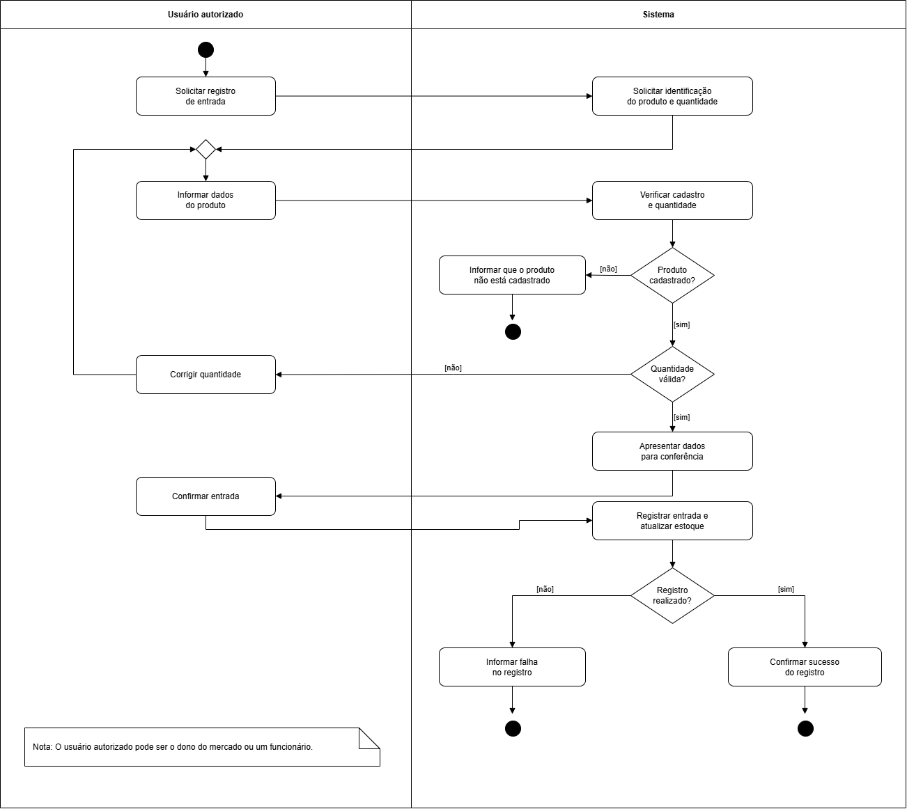

# 4.2.5 Modelagem de Atividade

## Do fluxo ao diagrama

O diagrama de atividades é o fluxo da 4.2.2 desenhado. A fonte é a especificação de **Registrar Entrada**: o fluxo principal, o alternativo A1 e as exceções E1 e E2. Nada entra no desenho que não esteja lá.

Três regras de tradução. Cada passo vira uma ação, na raia de quem faz. Cada "o sistema verifica" ou "o sistema confirma" vira uma ação seguida de uma decisão, porque verificar é perguntar. E cada alternativo ou exceção vira uma saída da decisão: o alternativo volta ao fluxo por uma junção, a exceção termina num fim próprio.

| No fluxo da 4.2.2 | Vira | Raia | Por quê |
|---|---|---|---|
| passo 1: o usuário solicita o registro de entrada de uma mercadoria | ação **Solicitar registro de entrada** | Usuário autorizado | quem age é o ator, e a ação fica na raia dele |
| passo 2: o sistema solicita a identificação do produto e a quantidade recebida | ação **Solicitar identificação do produto e quantidade** | Sistema | o sistema pede os dados necessários para iniciar a operação |
| passo 3: o usuário informa os dados da mercadoria | ação **Informar dados do produto** | Usuário autorizado | ação do ator fornecendo os dados solicitados |
| passo 4: o sistema verifica se o produto está cadastrado e se a quantidade informada é válida | ação **Verificar cadastro e quantidade**, e **duas decisões**: _Produto cadastrado?_ e _Quantidade válida?_ | Sistema | um passo com duas conferências esconde duas perguntas. A exceção E1 sai da primeira, e o alternativo A1 sai da segunda |
| E1: o produto não está cadastrado, o sistema informa e não registra a entrada | saída [não] da primeira decisão, ação **Informar que o produto não está cadastrado** e um **fim** próprio | Sistema | exceção não volta. O caso de uso termina sem a pós-condição, e o fim próprio indica isso |
| A1: a quantidade informada é inválida, o usuário informa uma quantidade válida e o fluxo volta ao passo 3 | saída [não] da segunda decisão, ação **Corrigir quantidade** e uma **junção** antes de Informar dados do produto | Usuário autorizado | alternativo é desvio que volta. A junção é o ponto em que o fluxo corrigido reencontra o caminho principal |
| passo 5: o sistema apresenta os dados da entrada para conferência | ação **Apresentar dados para conferência** | Sistema | o sistema exibe os dados validados antes da gravação |
| passo 6: o usuário confirma o registro da entrada | ação **Confirmar entrada** | Usuário autorizado | ação do ator validando a operação |
| passo 7: o sistema registra a movimentação e atualiza a quantidade disponível no estoque | ação **Registrar entrada e atualizar estoque**, e a decisão _Registro realizado?_ | Sistema | é necessário confirmar se a gravação no sistema ocorreu sem falha antes de encerrar |
| E2: ocorre uma falha no registro, o sistema informa e não atualiza o estoque | saída [não] da decisão, ação **Informar falha no registro** e um **fim** próprio | Sistema | segunda exceção, segundo fim sem a pós-condição |
| passo 8: o sistema confirma que a entrada foi registrada com sucesso | saída [sim] da decisão, ação **Confirmar sucesso do registro** e o **fim** do caminho feliz | Sistema | o passo que entrega a pós-condição. É o único fim em que o estoque foi atualizado |

## Diagrama de atividades

**Figura 3 – Diagrama de atividades de Registrar Entrada**

Fonte: Autoria própria (2026).

A Figura 3 tem duas raias. A da esquerda é do **Usuário autorizado** (dono do mercado ou funcionário com permissão), a da direita é do **Sistema**. Cada ação está na raia de quem a executa, e as setas cruzam de uma raia para a outra toda vez que a vez passa do usuário para o sistema ou vice-versa. Lendo de cima para baixo, o desenho representa exatamente a sequência descrita na seção 4.2.2.

O círculo cheio no alto é o **início**. Logo antes da ação **Informar dados do produto** há uma **junção**, o losango sem pergunta: é por ali que o fluxo alternativo A1 retorna após o usuário executar **Corrigir quantidade**. As três **decisões** são os losangos com pergunta, e cada uma possui duas saídas com a condição entre colchetes: `[sim]` e `[não]`.

Há três **fins**. O de baixo, na raia do Sistema, é o único em que a pós-condição acontece: a entrada fica registrada e a quantidade disponível do produto é atualizada no estoque. Os dois fins posicionados à direita encerram os fluxos de exceção E1 (produto não cadastrado) e E2 (falha no registro), mostrando claramente que a operação terminou sem concluir o registro. Um caso de uso que pode terminar de três maneiras diferentes precisa de três fins distintos.

Não há barra de sincronização (as barras grossas que dividem e unem caminhos paralelos). Nenhuma etapa de **Registrar Entrada** ocorre de forma simultânea: todas as ações acontecem em sequência, uma após a outra.

## Rastreabilidade com a 4.2.2

| Elemento do diagrama | Vem de | Confere |
|---|---|---|
| Solicitar registro de entrada, Informar dados do produto, Confirmar entrada | passos 1, 3 e 6 (Usuário autorizado) | três ações na raia do ator, uma para cada passo do fluxo principal |
| Corrigir quantidade e junção | A1 (no passo 4) | ação na raia do ator que retorna ao fluxo principal pela junção antes do passo 3 |
| Solicitar identificação do produto e quantidade, Verificar cadastro e quantidade, Apresentar dados para conferência, Registrar entrada e atualizar estoque, Confirmar sucesso do registro | passos 2, 4, 5, 7 e 8 (Sistema) | cinco ações na raia do sistema, correspondendo às operações `consultar()`, `registrar()` e `atualizarEstoque()` definidas na seção 4.2.3 |
| Produto cadastrado? [não] | E1 (no passo 4) | leva à ação de aviso e termina em fim próprio, sem a pós-condição |
| Quantidade válida? [não] | A1 (no passo 4) | desvia para a correção da quantidade e retorna ao fluxo principal |
| Registro realizado? [não] | E2 (no passo 7) | leva à ação de falha no registro e termina em fim próprio, sem a pós-condição |
| fim com a pós-condição | pós-condição da 4.2.2 | apenas o caminho principal (`[sim]` em todas as decisões) chega nele |

**Todo passo tem elemento.** Os oito passos do fluxo principal, o fluxo alternativo A1 e as exceções E1 e E2 estão representados no diagrama, e nenhum elemento foi criado fora da especificação da 4.2.2.

**Toda decisão tem as duas saídas.** Cada um dos três losangos de decisão possui uma saída `[sim]` e uma saída `[não]`, direcionando o fluxo para o caminho principal, para o alternativo A1 ou para as exceções E1 e E2.

**O que o desenho mudou.** O passo 4 da 4.2.2 agrupa duas validações na mesma frase ("verifica se o produto está cadastrado e se a quantidade informada é válida"). Ao desenhar o diagrama, ficou evidente que essa verificação se divide em duas decisões sequenciais, pois cada uma gera um desvio diferente: a falta de cadastro encerra o processo (E1), enquanto a quantidade inválida permite correção e retorno (A1). Da mesma forma, o passo 7 ganhou uma decisão explícita para representar a possibilidade de falha na gravação (E2).
