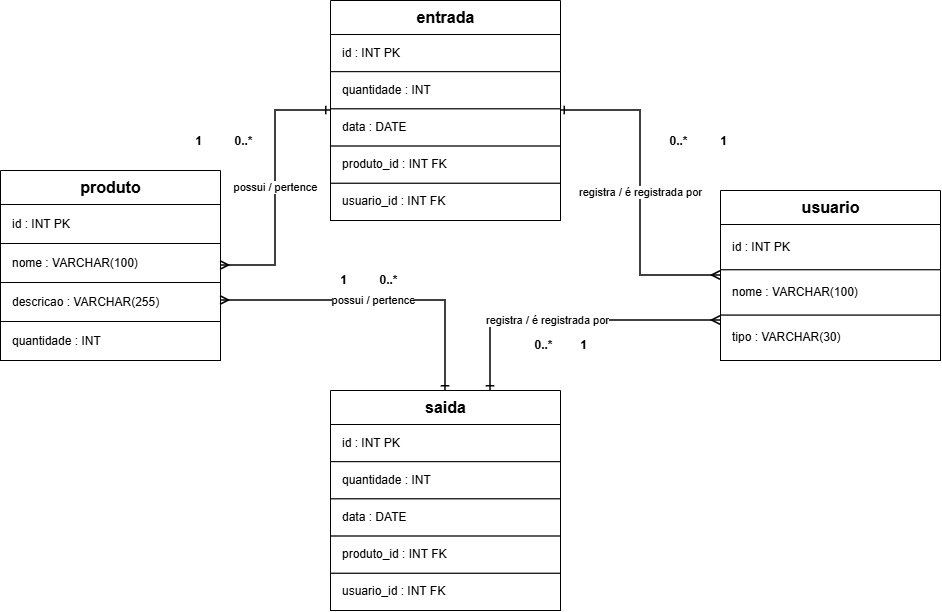

# 4.2.6 Modelagem de Banco de Dados

## Das classes às tabelas

A partir das classes definidas na seção 4.2.3, foi realizada a transformação do modelo de classes em tabelas para o banco de dados. Os atributos foram transformados em colunas, enquanto as operações foram mantidas como responsabilidades do sistema, sem serem armazenadas no banco.

| **Classe** | **Tabela** | **Decisão** |
| ---------- | ---------- | ----------- |
| Produto | `produto` | Os atributos da classe foram transformados em colunas. O atributo `idProduto` será representado pela chave primária `id`. |
| Entrada | `entrada` | Armazena os registros de entrada, incluindo quantidade, data, produto relacionado e usuário responsável. |
| Saida | `saida` | Armazena os registros de saída, incluindo quantidade, data, produto relacionado e usuário responsável. |
| Usuario | `usuario` | Armazena os dados dos usuários autorizados. O atributo `idUsuario` será representado pela chave primária `id`. |
| Estoque | — | Não terá tabela própria, pois representa uma funcionalidade de consulta. A quantidade disponível será obtida pelo atributo `quantidade` da tabela `produto`. |

As associações entre as classes também foram transformadas em relacionamentos entre as tabelas. Para isso, foram adicionadas chaves estrangeiras nas tabelas `entrada` e `saida`.

| **Associação na 4.2.3** | **Representação no banco** |
| ----------------------- | -------------------------- |
| Produto possui várias Entradas | `entrada.produto_id` referencia `produto.id`. |
| Produto possui várias Saídas | `saida.produto_id` referencia `produto.id`. |
| Usuario registra várias Entradas | `entrada.usuario_id` referencia `usuario.id`. |
| Usuario registra várias Saídas | `saida.usuario_id` referencia `usuario.id`. |

As operações das classes, como `registrar()`, `consultar()` e `validarQuantidade()`, não foram transformadas em colunas, pois representam ações executadas pelo sistema.

## Diagrama do banco de dados

**Figura 5 –** Diagrama do banco de dados do Sistema de Controle de Estoque.

**Fonte:** Autoria própria (2026).

O diagrama apresenta quatro tabelas: `produto`, `entrada`, `saida` e `usuario`. Cada tabela possui uma chave primária chamada `id`, responsável por identificar seus registros.

As tabelas `entrada` e `saida` possuem as chaves estrangeiras `produto_id` e `usuario_id`, que identificam o produto movimentado e o usuário responsável pelo registro.

Os relacionamentos são de um para muitos (1:N). Um produto pode possuir várias entradas e saídas, enquanto cada movimentação está relacionada a um único produto. Da mesma forma, um usuário pode registrar várias movimentações, mas cada entrada ou saída possui apenas um usuário responsável.

**Tipos de dados utilizados:**

- `INT`: números inteiros, utilizados nos identificadores e nas quantidades.
- `VARCHAR(100)`: textos com até 100 caracteres.
- `VARCHAR(255)`: textos com até 255 caracteres.
- `VARCHAR(30)`: textos com até 30 caracteres.
- `DATE`: armazenamento de datas.

Não foi utilizada herança, pois as classes não apresentam uma relação de especialização. Também não foi necessária uma tabela de associação para relacionamentos muitos-para-muitos, pois todos os relacionamentos identificados são de um para muitos.

## Rastreabilidade com a 4.2.3

Para verificar se a transformação foi realizada corretamente, foram utilizados os objetos apresentados no teste da seção 4.2.3. Cada objeto foi representado por um registro na tabela correspondente.

| **Tabela** | **Registro de teste** | **Valores** |
| ---------- | --------------------- | ----------- |
| `produto` | Produto arroz | `id = 1`, `nome = "Arroz"`, `descricao = "Pacote de arroz"`, `quantidade = 15` |
| `entrada` | Entrada entrada1 | `id = 1`, `quantidade = 20`, `data = 26/10/2026`, `produto_id = 1`, `usuario_id = 1` |
| `saida` | Saída saida1 | `id = 1`, `quantidade = 5`, `data = 26/10/2026`, `produto_id = 1`, `usuario_id = 1` |
| `usuario` | Usuário funcionario1 | `id = 1`, `nome = "Funcionário"`, `tipo = "Funcionário"` |

Os valores `produto_id = 1` nas tabelas `entrada` e `saida` indicam que as duas movimentações pertencem ao produto arroz. O valor `usuario_id = 1` indica que ambas foram registradas pelo funcionário identificado na tabela `usuario`.

A quantidade final do produto permanece em 15 unidades, considerando as 20 unidades recebidas e as 5 unidades retiradas.

A conferência da transformação apresentou os seguintes resultados:

- Todos os atributos que precisam ser armazenados possuem uma coluna correspondente.
- As operações das classes não foram transformadas em colunas ou tabelas.
- A classe `Estoque` não possui tabela própria, pois suas informações podem ser obtidas a partir dos produtos.
- Não foi utilizada herança nem relacionamento muitos-para-muitos.
- Todas as associações entre produtos, entradas, saídas e usuários possuem representação por chaves estrangeiras.

A modelagem mantém a correspondência com as classes da seção 4.2.3 e permite armazenar os produtos, registrar suas movimentações e identificar os usuários responsáveis. Dessa forma, o banco de dados atende à estrutura necessária para o funcionamento do Sistema de Controle de Estoque.
